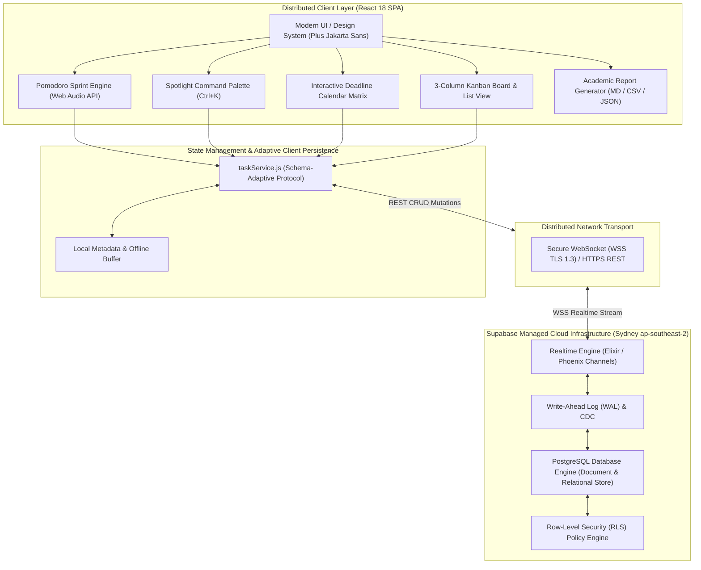

# 🚀 Student Sprint Cloud OS

<p align="center">
  
  
  
  
  
</p>

> **Semester Mini-Project:** Cloud & Distributed Computing  
> **Architecture Standard:** Series-A Startup SaaS (Linear / Notion Projects / Raycast inspired)  
> **Core Concept:** Multi-Client Real-Time Synchronization via PostgreSQL Change Data Capture (CDC) & WebSockets

---

## 🌟 Highlights & Features

### 1. ⏱️ Integrated Pomodoro Study Sprint Engine
- **Customizable Modes:** 25-min Focused Sprint, 5-min Short Break, 15-min Deep Recharge.
- **Active Coursework Docking:** Click the flame icon (`🔥`) on any task card to bind it directly into the Pomodoro engine (*"Focusing on: [Task Name]"*).
- **Web Audio API Sound Engine:** Zero external audio files required; synthesizes crystal-clear chime frequencies at runtime directly through the browser audio hardware.
- **Visual Sprint Tracking:** 4-sprint dot cycle tracker with completed session telemetry.

### 2. 📅 Interactive Deadline Calendar Matrix
- Monthly submission grid calculating dynamic 35-to-42 day matrices in $O(N)$ time.
- Priority-coded task chips (Urgent, High, Medium, Low) with today highlight and overdue warnings.
- Interactive day drawer for inspecting scheduled coursework and 1-click date scheduling.

### 3. 📊 3-Column Kanban Board & List View
- Seamless toggle between **Kanban Board** (`To Do Backlog`, `In Progress Sprint`, `Completed`) and **List View**.
- 1-click column shift controls (`←` and `→`) for rapid status transitions.
- Interactive card-level subtask checklists with live percentage progress bars.

### 4. ⚡ Spotlight Command Palette (`Ctrl + K` or `/`)
- Global keyboard-driven spotlight command center (Linear / Raycast style).
- Real-time fuzzy search across coursework tasks, navigation actions, and system commands.
- Quick triggers: Start Pomodoro, Switch Views, Toggle Dark/Light Mode, Export Reports, Cloud Settings.

### 5. 📑 Academic Submission & Export Suite
- **Academic Markdown Report (`.md`):** Formal semester coursework report with executive summary, tables, and milestone logs ready for evaluation.
- **Spreadsheet CSV (`.csv`):** Tabular coursework export with estimated workload hours and completion metrics for Excel / Google Sheets.
- **Database JSON (`.json`):** Full database JSON dump for automated grading scripts.

### 6. 📈 Academic Velocity & Realtime Telemetry
- Real-time KPIs: Completion Velocity %, Total Workload Volume (hrs), In-Progress Sprint, Deadline Health.
- Workload breakdown progress bars categorized by course module (`Cloud Computing`, `Distributed Systems`, etc.).
- Distributed infrastructure metrics: Live latency ping (ms), Sydney datacenter status (`ap-southeast-2`), WebSocket protocol (TLS 1.3).

### 7. ☁️ Adaptive Supabase Realtime Architecture
- Dual-mode persistence: Connected directly to live Supabase Cloud PostgreSQL with WebSocket replication.
- Resilient schema-adaptive layer: works seamlessly with both basic and extended Postgres columns without crashing or dropping metadata.
- Multi-tab synchronization via WebSocket and browser storage events.

---

## 🏗️ Distributed System Architecture



---

## 🚀 Getting Started

### Prerequisites
- [Node.js](https://nodejs.org/) (v18.0 or newer)
- npm or pnpm

### Installation

1. **Clone the repository:**
   ```bash
   git clone https://github.com/YOUR_USERNAME/student-task-manager.git
   cd student-task-manager
   ```

2. **Install dependencies:**
   ```bash
   npm install
   ```

3. **Configure Environment Variables:**
   Copy the example environment file:
   ```bash
   cp .env.example .env
   ```
   Provide your Supabase URL and Publishable Anon Key in `.env`:
   ```env
   VITE_SUPABASE_URL=https://your-project-id.supabase.co
   VITE_SUPABASE_ANON_KEY=your-publishable-key-here
   ```
   *(Note: The app includes a zero-config local fallback mode that works out-of-the-box even without Supabase credentials).*

4. **Start the development server:**
   ```bash
   npm run dev
   ```
   Open **[http://localhost:3000](http://localhost:3000)** in your browser.

5. **Build for Production:**
   ```bash
   npm run build
   ```

---

## 🗄️ Supabase Cloud Database Schema

To set up the cloud database in Supabase:
1. Open the **SQL Editor** in your [Supabase Dashboard](https://supabase.com/dashboard).
2. Execute the schema from `supabase_schema.sql`:

```sql
-- 1. Create tasks table
CREATE TABLE IF NOT EXISTS public.tasks (
    id UUID PRIMARY KEY DEFAULT gen_random_uuid(),
    title TEXT NOT NULL,
    subject TEXT NOT NULL DEFAULT 'General',
    description TEXT DEFAULT '',
    due_date DATE NOT NULL,
    is_completed BOOLEAN NOT NULL DEFAULT false,
    status TEXT NOT NULL DEFAULT 'todo',
    priority TEXT NOT NULL DEFAULT 'medium',
    estimated_hours NUMERIC DEFAULT 2,
    subtasks JSONB DEFAULT '[]'::jsonb,
    created_at TIMESTAMP WITH TIME ZONE DEFAULT timezone('utc'::text, now()) NOT NULL
);

-- 2. Enable Row Level Security (RLS)
ALTER TABLE public.tasks ENABLE ROW LEVEL SECURITY;

-- 3. Allow public read/write policy for academic evaluation
CREATE POLICY "Allow public read and write access for tasks"
ON public.tasks FOR ALL
USING (true)
WITH CHECK (true);

-- 4. Enable Realtime Replication for the tasks table
ALTER PUBLICATION supabase_realtime ADD TABLE public.tasks;
```

---

## ⌨️ Power-User Keyboard Shortcuts

| Shortcut | Action |
| :--- | :--- |
| `Ctrl + K` or `Cmd + K` | Open Spotlight Command Palette |
| `/` | Quick Search Coursework |
| `N` | Open New Task / Assignment Modal |
| `D` | Toggle Dark / Light Theme Mode |
| `?` | Show Keyboard Shortcuts Dialog |
| `Esc` | Close Active Modal or Drawer |

---

## 🎓 Academic Viva & Defense Questions

<details>
<summary><b>1. What makes this architecture "distributed" rather than a traditional web application?</b></summary>
In a traditional web application, clients query a server on demand, and data remains isolated until a user refreshes. In this architecture, state is distributed across multiple autonomous nodes (browser tabs, devices, cloud PostgreSQL). State changes propagate automatically via Write-Ahead Log (WAL) Change Data Capture over bidirectional WebSockets, maintaining shared distributed state across all clients in real time.
</details>

<details>
<summary><b>2. How does Supabase Realtime work under the hood?</b></summary>
Supabase Realtime uses an Elixir/Phoenix cluster that attaches to PostgreSQL's replication slot. When an SQL transaction commits (`INSERT`, `UPDATE`, `DELETE`), PostgreSQL records it in the Write-Ahead Log (WAL). Realtime reads the WAL stream, filters changes by publication tables, and emits WebSocket broadcast messages to subscribed clients on matching channels.
</details>

<details>
<summary><b>3. How does the system handle temporary network partitions?</b></summary>
The application implements an adaptive dual-mode architecture. If the connection to Supabase fails or is severed, the client falls back to local storage and dispatches HTML5 `storage` events across local tabs. When network connectivity is restored, the Supabase client re-establishes the WebSocket connection and re-fetches the latest state from PostgreSQL.
</details>

<details>
<summary><b>4. Why use the Web Audio API instead of static .mp3 files?</b></summary>
Web Audio API synthesizes frequency waveforms directly in the browser's audio processor at runtime. This eliminates network requests for static assets, guarantees zero latency, prevents missing file errors, and requires zero external bandwidth.
</details>

---

## 📄 License

This project is licensed under the MIT License - see the [LICENSE](LICENSE) file for details.
